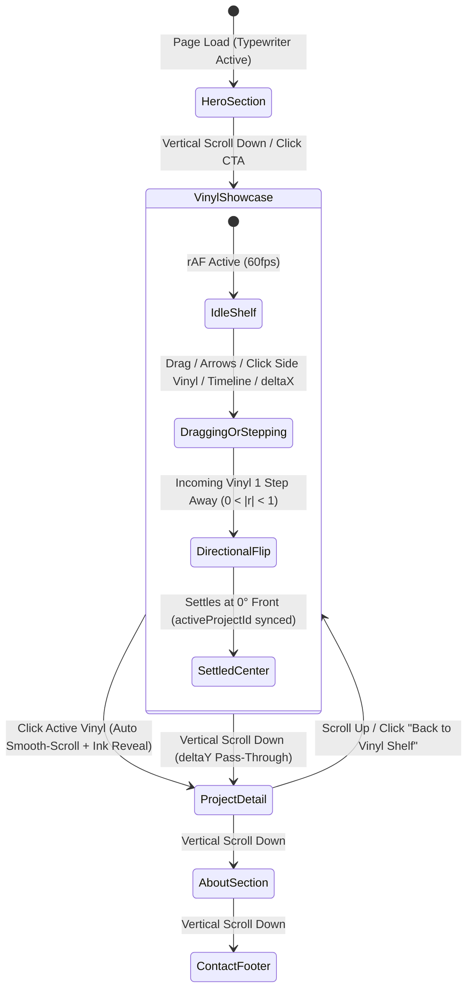

# Technical Architecture & Monorepo Blueprint — Portfolio Dimas Saputra

> **Stack Utama:** Next.js (App Router) + TypeScript + Tailwind CSS v4 + Dedicated CSS Module (`VinylShelf.module.css`)  
> **Arsitektur Repository:** Monorepo (`pnpm workspaces`) — semua aplikasi, dokumentasi, dan aset mentah tertata rapi dalam 1 repo ini.  
> **Target Performa:** `60fps` stabil pada animasi 3D Vinyl, `LCP < 1.8s`, `CLS = 0`, `0%` CPU idle saat 3D di luar layar.

---

## 1. Monorepo Directory Structure & Workspace Tidying Plan

Saat kita mulai men-scaffold aplikasi di langkah implementasi berikutnya, seluruh file yang saat ini masih tersebar di root akan dirapikan ke struktur monorepo berikut:

```text
e:\PORTO\Porto serius\
├── PRD.md                            # Product Requirements & Section Validation (Root)
├── ARCHITECTURE.md                   # Dokumen Arsitektur Teknis ini (Root)
├── RULES.md                          # Design System, Anti-AI-Slop & Coding Rules (Root)
├── package.json                      # Root Monorepo Workspace config (pnpm / npm workspaces)
├── pnpm-workspace.yaml               # Workspace declaration: apps/*, packages/*
│
├── apps/
│   └── web/                          # Aplikasi Utama Next.js (App Router + TypeScript)
│       ├── next.config.ts            # Image optimization, strict headers, static/edge config
│       ├── public/
│       │   ├── assets/
│       │   │   ├── vinyl/            # Aset final WebP transparan (<200KB per file)
│       │   │   │   ├── sebatik.webp
│       │   │   │   ├── skynet.webp
│       │   │   │   ├── psychobot.webp
│       │   │   │   ├── natasha.webp
│       │   │   │   ├── esc.webp
│       │   │   │   ├── loghub.webp
│       │   │   │   ├── grace.webp
│       │   │   │   └── vinyl-backs-sheet.webp   # Sprite sheet 4x2 (1 file untuk 7 belakang)
│       │   │   └── screenshots/      # (Opsional) Screenshot UI asli project untuk Section 03
│       │   └── cv/                   # (Opsional) File CV PDF
│       └── src/
│           ├── app/
│           │   ├── layout.tsx        # Self-hosted Inter Tight (next/font), Paper Grain, Global Navbar
│           │   ├── page.tsx          # Main Portfolio Page (orchestrates Sections 01 -> 05)
│           │   ├── globals.css       # Locked CSS tokens (--paper, --sheet, --ink, --cobalt, --rule)
│           │   └── (future-phase2)/  # Reserved routes: /certifications, /journal
│           ├── data/
│           │   ├── profile.ts        # Data Hero, About, Experience, Capabilities, Contact
│           │   └── projects.ts       # Single Source of Truth untuk 7 Project Vinyl + Back Cell Crop + Case Study
│           ├── hooks/
│           │   ├── useTypewriter.ts  # Zero-dependency lightweight typewriter hook (Hero)
│           │   ├── useInViewport.ts  # IntersectionObserver hook untuk pause/resume animasi
│           │   └── useCustomCursor.ts# Smooth lerp custom cursor (pointer: fine only)
│           └── components/
│               ├── layout/
│               │   ├── GlobalNavbar.tsx         # Minimalist antigravity.google-inspired Navbar
│               │   ├── PaperGrainOverlay.tsx    # Static 220px SVG fractalNoise overlay
│               │   └── CustomCursor.tsx         # Cobalt/Ink interactive cursor
│               ├── sections/
│               │   ├── HeroSection.tsx          # Section 01: Live-Typing Landing Page
│               │   ├── VinylShowcaseSection.tsx # Section 02: Curved Slim 3D Vinyl LP Shelf
│               │   ├── ProjectDetailSection.tsx # Section 03: Active Project Case Study (linked to Section 02)
│               │   ├── AboutSection.tsx         # Section 04: Editorial About & Experience
│               │   └── ContactFooterSection.tsx # Section 05: Minimalist Contact & Footer
│               └── vinyl/
│                   ├── VinylShelf.module.css    # Dedicated 3D CSS (preserve-3d, backface-visibility, slim edges)
│                   ├── arcMath.ts               # Pure TypeScript math: F(r), B(r), scl(u), XS integral, navDir spin
│                   └── InkRevealPoster.tsx      # SVG feTurbulence + feDisplacementMap ink-bleed artwork reveal
│
├── packages/                         # Disiapkan untuk shared config/UI di Phase 2
│   └── tsconfig/                     # (Opsional) Shared TypeScript config
│
├── docs/                             # Arsip rapi untuk prompt & catatan brainstorming
│   ├── prompts/
│   │   ├── prompt-vinyl-3d.md        # (Dipindahkan dari root: prompt.md)
│   │   └── prompt-generate-img.md    # (Dipindahkan dari root: propmt generate.md)
│   └── notes/
│       ├── BRAINSTORMING.txt         # (Dipindahkan dari root)
│       ├── project-kita.txt          # (Dipindahkan dari root: project kita.txt)
│       └── prompt-isi-layout.txt     # (Dipindahkan dari root: Prompt isi layout.txt)
│
└── assets-raw/                       # (Dipindahkan dari Souce/) Semua aset mentah & backup
    ├── logos/                        # Souce/logo/
    ├── templates/                    # Souce/Template/
    └── vinyl-renders/                # Souce/Jadi/ (JPG asli + PNG mentah + PNG Compress)
```

> **Catatan Pemindahan File:** File lama (`Souce/`, `BRAINSTORMING.txt`, `project kita.txt`, `Prompt isi layout.txt`, `prompt.md`, `propmt generate.md`) **tidak akan dihapus** — saat scaffolding monorepo dijalankan, seluruhnya hanya dipindahkan rapi ke `docs/` dan `assets-raw/` agar root tetap bersih dan zero data hilang.

---

## 2. State & Interaction Flow Architecture (Section 02 ↔ Section 03)

Salah satu fondasi UX terpenting di portfolio ini adalah hubungan langsung antara **Section 02 (Vinyl Shelf)** dan **Section 03 (Project Detail)**, sekaligus **Scroll Contract** agar pengunjung tidak pernah terjebak:



### 2.1 Shared State Management (Ringan, Tanpa Redux/Zustand)
- `PortfolioShell.tsx` (Client wrapper tipis di `page.tsx`) menyimpan state ringan:
  - `activeProjectId: ProjectId` (default: `'javaskripsi'` / NATASHA, sinkron otomatis saat vinyl di Section 02 berhenti pada indeks baru atau saat tombol Prev/Next di Section 03 diklik).
  - `revealNonce: number` (increment saat user mengklik vinyl di Section 02 untuk memicu animasi *ink-bleed* & *mask-slide* segar pada Section 03).
- **Click-to-Open Flow:**
  1. User klik vinyl aktif di tengah Section 02 (atau tekan `Enter`).
  2. `handleOpenProject(project.id)` meng-update `activeProjectId` + `revealNonce`.
  3. Memanggil `document.getElementById('project-detail')?.scrollIntoView({ behavior: 'smooth', block: 'start' })`.
  4. Section 03 langsung menampilkan detail project yang diklik dengan transisi *mask-slide* pada teks dan *ink-bleed* pada artwork!
- **Vertical Scroll Pass-Through Contract:**
  - Event `wheel` di Section 02 **HANYA** memproses geser horizontal (`Math.abs(e.deltaX) > Math.abs(e.deltaY)`).
  - Scroll vertikal (`e.deltaY`) **tidak pernah di-`preventDefault()`**, sehingga scroll mouse ke bawah dari Section 02 otomatis meluncur mulus langsung ke Section 03!

---

## 3. Lightweight 60fps 3D Performance Architecture

Karena Section 02 menampilkan **35 virtual slim 3D vinyl cards** (`7 projects × 5 copies`) secara real-time, arsitektur berikut wajib diterapkan agar website sangat enteng:

### 3.1 Zero Heavy Runtime Dependencies
- **Tidak memakai Three.js, React Three Fiber, atau GSAP.**
- Seluruh 3D shelf berjalan di atas **1 fungsi `requestAnimationFrame` tunggal** yang langsung memutasi `element.style.transform` dan CSS custom property `--shade` via DOM refs (`useRef<HTMLDivElement[]>`) — **0 React re-render per frame!**
- React state hanya di-update **1 kali saat `activeIndex` berubah** (untuk *mask-slide* caption & sinkronisasi Section 03).

### 3.2 Viewport-Gated `requestAnimationFrame` (`IntersectionObserver`)
- `VinylShowcaseSection` memasang `IntersectionObserver` (`rootMargin: '200px 0px'`).
- Saat Section 02 berada **di luar layar** (user sedang membaca Hero, Section 03 Detail, About, atau Contact), loop `rAF` **dihentikan sepenuhnya (`cancelAnimationFrame`)** → **0% beban CPU/GPU di background**.
- Begitu Section 02 mendekati viewport (`200px` sebelum terlihat), loop `rAF` otomatis aktif kembali dengan `dt` di-cap maksimal `50ms` agar tidak ada lompatan posisi.

### 3.3 GPU Layer & Filter Optimization
- **Culling Off-Arc Nodes:** Item dengan `|u| > U · 1.95` langsung di-set `visibility: hidden` dan tidak dihitung transform/filter-nya.
- **Selective Drop-Shadow:** `filter: drop-shadow(...)` pada transparent PNG cukup berat jika dipasang di 35 elemen sekaligus. Aturan optimasi:
  - Hanya 3 item paling dekat ke tengah (`|r| < 1.35`) yang mendapat `drop-shadow` lembut.
  - Item di sisi kiri/kanan jauh (`|r| ≥ 1.35`) hanya menggunakan `filter: brightness(...)` ringan (sangat murah di GPU) + bayangan lantai bersama (`.floor-shadow`).
- **Back-Face Sprite Sheet Single Request:** Semua 7 tampilan belakang vinyl hanya memuat **1 request HTTP tunggal** (`vinyl-backs-sheet.webp`) menggunakan CSS `background-size: 400% 200%`.

### 3.4 Image Asset Optimization Pipeline
Saat ini 8 file di `Souce/Jadi/PNG/Compress/` berukuran `522 KB – 1,021 KB` (total `~6.3 MB`).
Saat migrasi ke `apps/web/public/assets/vinyl/`, kita akan menjalankan skrip optimasi satu kali (menggunakan `sharp`) untuk mengonversi semuanya menjadi **Transparent WebP**:
- **7 Front Vinyls:** resize max width `1200px` (aspect `3:2`), WebP lossless/quality `84` → target **`100–180 KB` per file**.
- **1 Back Sprite Sheet (`4 × 2`):** resize max width `2400px`, WebP quality `82` → target **`180–260 KB`**.
- **Total seluruh aset 3D Vinyl:** turun dari `~6.3 MB` menjadi **`~1.1 MB` total** (hemat `> 80%`)!
- **Prioritized Preload:** Preload `NATASHA` (initial center) + 2 tetangganya (`PSYCHOBOT`, `ESC`) + `vinyl-backs-sheet.webp` lebih dulu; sisanya preload di idle (`requestIdleCallback`).

---

## 4. Data Schema (`apps/web/src/data/projects.ts`)

```ts
export interface ProjectItem {
  id: 'sebatik' | 'skynet' | 'psychobot' | 'javaskripsi' | 'esc' | 'loghub' | 'grace';
  code: string;               // e.g. "D! — 01"
  title: string;              // e.g. "Sebatik"
  subtitle: string;           // e.g. "INDONESIAN BATIK DIGITAL PLATFORM"
  year: number;               // e.g. 2023
  timelineYear: number;       // 2023.0 .. 2026.0 (0.5 increments for smooth dot spacing)
  theme: string;              // e.g. "Heritage & Web App"
  role: string;               // e.g. "Full-Stack Dev"
  edgeColor: string;          // Exact HEX from Souce/Jadi/ (e.g. "#1D140B")
  frontImage: string;         // "/assets/vinyl/sebatik.webp"
  backCell: [col: number, row: number]; // [0..3, 0..1] on vinyl-backs-sheet.webp
  synopsis: string;
  highlights: string[];       // 2-3 bullet points for Section 03
  techStack: string[];        // e.g. ["Next.js", "TypeScript"]
  demoUrl?: string;
  repoUrl?: string;
  screenshots?: string[];
}
```

---

## 5. Build, Fonts & Deployment Strategy

- **Fonts (`next/font/google`):** `Inter_Tight` (variable weights `400`–`800`), `display: 'swap'`, subset `latin` — di-self-host otomatis oleh Next.js tanpa request eksternal saat runtime.
- **Static Rendering:** Halaman utama (`page.tsx`) dapat di-prerender statis (SSG) sehingga TTFB nyaris instan saat di-deploy ke **Vercel** atau **Cloudflare Pages**.
- **Future Phase 2 Extensibility:** Struktur App Router langsung mendukung penambahan `src/app/certifications/page.tsx` dan `src/app/journal/page.tsx` tanpa merombak komponen inti.
